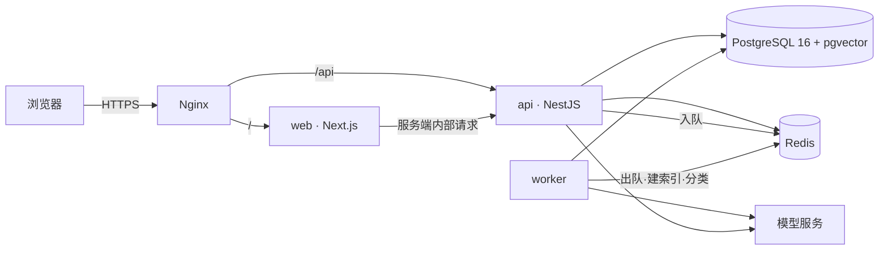

# TicketDesk

面向中小团队的服务工单平台。客户提交请求，团队成员分类、指派、处理、回复；系统负责记录全过程，并用模型完成自动分类与回复建议。

## 产品边界

**做什么**

- 多组织（租户）隔离，一个用户可以属于多个组织
- 工单全生命周期：创建 → 分类 → 指派 → 处理 → 解决 → 关闭
- 评论与内部备注分离（内部备注不对客户可见）
- 附件上传与下载
- 知识库文章，作为回复建议的检索来源
- 模型能力：工单自动分类、基于知识库的回复建议、自然语言统计查询
- 全链路审计：每一次状态变更、指派、评论都留痕

**不做什么**

- 计费与订阅
- 邮件 / IM 通知（留接口位，不实现）
- 多语言
- 移动端

## 架构



- `apps/web` — 页面与 SSR。不承载业务逻辑，所有数据经 `apps/api`。
- `apps/api` — 全部 HTTP 接口、鉴权、权限、领域逻辑。
- `apps/worker` — 异步任务：知识库切块与向量化、工单自动分类、超时任务。
- `packages/shared` — 前后端共用的类型、DTO、错误码。契约的唯一来源。

## 技术栈

| 层 | 选型 | 说明 |
|---|---|---|
| 前端 | Next.js 16 (App Router) + TypeScript + Tailwind | 仅 UI 与 SSR |
| 后端 | NestJS 11 + TypeScript | 独立进程、独立端口 |
| 数据库 | PostgreSQL 16 + pgvector | 业务数据与向量同库 |
| 缓存/队列 | Redis 7 + BullMQ | 队列、限流计数、会话黑名单 |
| ORM | Prisma（常规 CRUD）+ 原生 SQL（向量、聚合） | 见 ADR-0004 |
| 容器 | Docker Compose | 本地与单机生产同构 |
| 入口 | Nginx | 反向代理、TLS、静态缓存 |
| CI | GitHub Actions | 测试、构建镜像、部署 |

## 目录

```
ticket-platform/
├── apps/
│   ├── api/                 NestJS 服务
│   ├── web/                 Next.js 应用
│   └── worker/              异步任务进程
├── packages/
│   └── shared/              共享类型、DTO、错误码
├── infra/
│   ├── docker/init/         数据库初始化脚本（扩展、角色）
│   └── nginx/               反向代理与 TLS 配置
├── docs/
│   ├── erd.md               数据模型
│   ├── api-v1.md            接口契约
│   ├── response-format.md   统一响应与错误码
│   ├── conventions.md       提交、分支、命名规范
│   └── adr/                 架构决策记录
├── docker-compose.yml
└── .env.example
```

## 本地启动

前置：Docker Desktop、Node 22、pnpm。

```bash
cp .env.example .env          # 首次
pnpm install
pnpm db:up                    # 起 PostgreSQL 与 Redis
pnpm db:psql                  # 验证连通
```

应用尚在按里程碑逐层接入，启动命令随各里程碑补齐。

## 环境变量

全部通过根目录 `.env` 注入，代码中不出现任何硬编码连接串或密钥。字段说明见 `.env.example`。

## 文档

- [数据模型](docs/erd.md)
- [接口契约 v1](docs/api-v1.md)
- [统一响应与错误码](docs/response-format.md)
- [工程规范](docs/conventions.md)
- [架构决策记录](docs/adr/)
