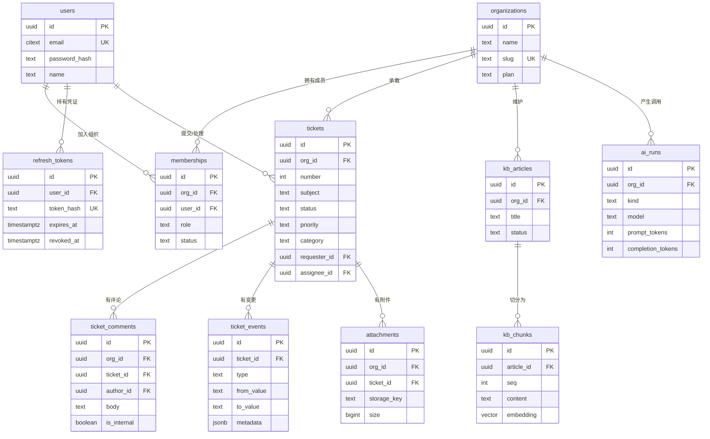

# 数据模型

版本：v1（2026-11-02）
状态：已定稿，变更需提交 ADR 并同步 `packages/shared` 中的类型。

## 总览

十一个实体，按三个域分组：

| 域 | 表 | 职责 |
|---|---|---|
| 身份与组织 | `organizations` | 租户。所有业务数据的归属根 |
| | `users` | 全局账号。一个人可跨多个组织 |
| | `memberships` | 用户 × 组织的关联，角色挂在关系上 |
| | `refresh_tokens` | 可吊销的长效凭证 |
| 工单 | `tickets` | 工单主体与状态 |
| | `ticket_comments` | 公开回复与内部备注 |
| | `ticket_events` | 全量变更审计 |
| | `attachments` | 附件元数据 |
| 知识与模型 | `kb_articles` | 知识库文章 |
| | `kb_chunks` | 文章切块 + 向量 |
| | `ai_runs` | 每次模型调用的成本与耗时记录 |

## 关系图

## 通用约定

- 主键统一 `uuid`，由数据库 `gen_random_uuid()` 生成。不用自增整数：ID 会出现在 URL 里，自增值会泄露业务量，也让跨环境数据迁移变麻烦。
- 时间统一 `timestamptz`，应用层不存本地时间。展示时区由前端决定。
- 所有业务表带 `org_id`，且**每个查询都必须带它**。这是多租户隔离的第一道防线，第二道是行级安全策略（见 ADR-0002）。
- 命名：数据库 `snake_case`，TypeScript `camelCase`，Prisma 用 `@map` / `@@map` 做映射。不做全局自动转换——隐式转换在排查问题时是灾难。
- 每个实体都有 `created_at`、`updated_at`。`updated_at` 由 Prisma `@updatedAt` 维护。

---

## 身份与组织

### organizations

| 字段 | 类型 | 说明 |
|---|---|---|
| `id` | uuid PK | |
| `name` | text | 组织显示名 |
| `slug` | text UK | URL 片段，创建后不可改 |
| `plan` | text | `free` / `pro`，默认 `free` |
| `created_at` / `updated_at` | timestamptz | |

- 唯一索引：`slug`。登录后直接凭 slug 拼路径，需要全局唯一。
- 为什么不需要 `deleted_at`：组织不做软删除，删组织等于删全部数据，走后台流程而不是接口。

### users

| 字段 | 类型 | 说明 |
|---|---|---|
| `id` | uuid PK | |
| `email` | text UK | 写入前统一转小写，并用 `CHECK (email = lower(email))` 钉死。放弃 `citext`：Prisma 无法表达该类型，`@unique` 会与库里的实际类型产生漂移（见 ADR-0005） |
| `password_hash` | text | argon2id。库中永不出现明文或可逆密文 |
| `name` | text | 显示名 |
| `avatar_url` | text? | |
| `email_verified_at` | timestamptz? | 为 null 表示未验证 |
| `last_login_at` | timestamptz? | 安全审计用 |
| `created_at` / `updated_at` | timestamptz | |

- 唯一索引：`email`。
- 用户是全局实体，不属于任何组织。归属关系放在 `memberships`，因为一个人会加入多个组织、在不同组织里有不同角色。

### memberships

| 字段 | 类型 | 说明 |
|---|---|---|
| `id` | uuid PK | |
| `org_id` | uuid FK → organizations | 级联删除 |
| `user_id` | uuid FK → users | 级联删除 |
| `role` | text | `owner` / `admin` / `agent` / `viewer` |
| `status` | text | `active` / `invited` / `suspended` |
| `invited_by` | uuid? | 谁邀请的 |
| `created_at` / `updated_at` | timestamptz | |

- 唯一索引：`(org_id, user_id)`。同一个人在同一组织里只能有一条关系。
- 索引：`user_id`。登录后要查"我属于哪些组织"，反向查也必须走索引。
- 角色放在关系表而不是用户表：角色是"在这个组织里"的属性。一个用户可以是 A 组织的 owner、B 组织的 viewer，放用户表上就表达不了。
- `owner` 唯一性由应用层保证（组织创建时写入），不做数据库约束——数据库层面表达"每个 org 只能有一个 owner"需要部分唯一索引，代价大于收益。

### refresh_tokens

| 字段 | 类型 | 说明 |
|---|---|---|
| `id` | uuid PK | |
| `user_id` | uuid FK → users | 级联删除 |
| `token_hash` | text UK | 只存 SHA-256 哈希，不存原值。库被读走也无法直接使用 |
| `expires_at` | timestamptz | |
| `revoked_at` | timestamptz? | 非空即已吊销 |
| `replaced_by_id` | uuid? | 轮换时指向新凭证，用于检测重放 |
| `user_agent` | text? | 设备列表展示与异常登录判断 |
| `ip` | inet? | |
| `created_at` | timestamptz | |

- 唯一索引：`token_hash`。校验时按哈希查，等于查主键。
- 索引：`(user_id, revoked_at)`。"退出全部设备"要一次吊销某人所有有效凭证。
- 每次刷新都轮换：旧 token 标记吊销并记下 `replaced_by_id`。同一个旧 token 被用第二次，说明它泄露了，直接吊销该用户全部凭证。

---

## 工单域

### tickets

| 字段 | 类型 | 说明 |
|---|---|---|
| `id` | uuid PK | |
| `org_id` | uuid FK → organizations | |
| `number` | int | 组织内序号，对外展示为 `#1024` |
| `subject` | text | 标题，1~200 字符 |
| `description` | text | 正文 |
| `status` | text | `open` / `pending` / `resolved` / `closed` |
| `priority` | text | `low` / `normal` / `high` / `urgent` |
| `category` | text? | 业务分类，由人工或模型写入 |
| `requester_id` | uuid FK → users | 提交人 |
| `assignee_id` | uuid? FK → users | 处理人，可空（未指派） |
| `source` | text | `web` / `email` / `api` |
| `first_response_at` | timestamptz? | 首次响应时间，SLA 计算基准 |
| `sla_due_at` | timestamptz? | SLA 到期时间。建单时按优先级策略算好落库，可空表示不受 SLA 约束 |
| `resolved_at` | timestamptz? | |
| `closed_at` | timestamptz? | |
| `ai_category` | text? | 模型给出的分类，与人工 `category` 分开存 |
| `ai_confidence` | numeric(4,3)? | 置信度，低于阈值不自动采用 |
| `created_at` / `updated_at` | timestamptz | |

索引与理由：

| 索引 | 服务的查询 |
|---|---|
| `(org_id, status, created_at DESC)` | 列表页主查询：某组织某状态按时间倒序。这是最高频的路径，索引顺序按选择性从高到低 |
| `(org_id, assignee_id, status)` | “我的工单”，工作台首屏 |
| `(org_id, number) UNIQUE` | 按编号直达。也就保证组织内序号不重复 |
| `(org_id, created_at DESC)` | 统计与导出，避免全表扫 |
| `(org_id, sla_due_at)` | SLA 看板：某组织快到期 / 已超期的工单。等值列在前、范围列在后 |
| GIN `to_tsvector('simple', subject \|\| ' ' || description)` | 全文搜索。用 `simple` 而非 `english`：中文分词交给应用层，这里只做基础词元 |
| GIN `subject gin_trgm_ops` | 标题模糊匹配，支撑 `ILIKE '%关键词%'` |

设计说明：

- **`category` 和 `ai_category` 分开。** 模型输出是建议，不是事实。合并成一个字段会让"模型改错了人工判断"无从追溯，也没法统计模型的准确率。
- **`number` 不做全局自增。** 编号对外可见，全局自增会暴露平台总单量。用 `(org_id, number)` 唯一 + 事务内取 `max(number) + 1`，配合行锁保证不撞号。
- **状态变更不直接改字段了事。** 每次变更同时写一条 `ticket_events`，两件事在同一个事务里。
- **`first_response_at` 单独存。** 想统计 SLA 时用 `created_at` 和第一条公开评论的时间去算，等于每次统计都做一次关联聚合。落成字段是一次写入换无数次读取。
- **`sla_due_at` 落库而不是每次算。** 到期时间 = 建单时间 + 优先级对应的时限，时限来自组织配置。每次查询再去 join 配置表算一遍，就没法在 `sla_due_at` 上建索引，SLA 看板只能全表扫。落成字段后 `(org_id, sla_due_at)` 一条索引就能出「今天到期的」。

### ticket_comments

| 字段 | 类型 | 说明 |
|---|---|---|
| `id` | uuid PK | |
| `org_id` | uuid FK | |
| `ticket_id` | uuid FK → tickets | 级联删除 |
| `author_id` | uuid FK → users | |
| `body` | text | Markdown 原文 |
| `is_internal` | boolean | true = 内部备注，客户不可见 |
| `created_at` / `updated_at` | timestamptz | |

- 索引：`(ticket_id, created_at)`。详情页按时间正序拉全部评论，一个索引走完。
- `is_internal` 的过滤必须在服务端完成。这不是前端隐藏——越权读内部备注是真实事故，接口层必须按角色裁剪。

### ticket_events

| 字段 | 类型 | 说明 |
|---|---|---|
| `id` | uuid PK | |
| `org_id` | uuid FK | |
| `ticket_id` | uuid FK → tickets | RESTRICT：审计记录不能被工单的级联删除带走 |
| `actor_id` | uuid? | 操作人，系统自动变更为 null |
| `type` | text | `created` / `status_changed` / `assigned` / `priority_changed` / `commented` / `attachment_added` |
| `from_value` | text? | 变更前 |
| `to_value` | text? | 变更后 |
| `metadata` | jsonb | 附加信息，如指派给谁 |
| `created_at` | timestamptz | |

- 索引：`(ticket_id, created_at)`。详情页时间线一次查出。
- 索引：`(org_id, type, created_at)`。支撑"本周解决率"这类统计。
- **只追加，不修改不删除。** 审计表的价值在于不可篡改。应用层不提供任何更新或删除该表的接口，数据库层面用触发器拦截 UPDATE / DELETE。
- **外键是 RESTRICT 而不是 CASCADE。** 级联删除会把审计记录一并抹掉，等于没有审计。代价是工单不能物理删除，必须走 `deleted_at` 软删除——这本来就是设计要求。

### attachments

| 字段 | 类型 | 说明 |
|---|---|---|
| `id` | uuid PK | |
| `org_id` | uuid FK | |
| `ticket_id` | uuid? FK | 可挂在工单或评论上 |
| `comment_id` | uuid? FK | |
| `uploader_id` | uuid FK → users | |
| `file_name` | text | 原始文件名，仅用于展示 |
| `mime_type` | text | 服务端嗅探得出，不信任客户端声明 |
| `size` | bigint | 字节 |
| `storage_key` | text | 存储层路径，不含文件名语义 |
| `checksum` | text | SHA-256，用于去重与完整性校验 |
| `created_at` | timestamptz | |

- 索引：`(org_id, ticket_id)`。
- **`storage_key` 与 `file_name` 分离。** 用原始文件名做存储路径会带来路径穿越、同名覆盖、中文编码三类问题。存储键用 `org/{org_id}/{yyyy}/{mm}/{uuid}`。
- 数据库只存元数据，文件本身在对象存储或本地目录。库和文件分开才能各自扩容。

---

## 知识与模型

### kb_articles

| 字段 | 类型 | 说明 |
|---|---|---|
| `id` | uuid PK | |
| `org_id` | uuid FK | |
| `title` | text | |
| `content` | text | Markdown 原文 |
| `status` | text | `draft` / `published` / `archived` |
| `author_id` | uuid FK → users | |
| `indexed_at` | timestamptz? | 最近一次建索引的时间 |
| `created_at` / `updated_at` | timestamptz | |

- 索引：`(org_id, status, updated_at DESC)`。
- 只有 `published` 的文章参与检索。草稿进了索引，模型就会拿未定稿的内容回答客户。

### kb_chunks

| 字段 | 类型 | 说明 |
|---|---|---|
| `id` | uuid PK | |
| `org_id` | uuid FK | 冗余存储，检索时直接按它过滤，少一次 JOIN |
| `article_id` | uuid FK → kb_articles | 级联删除 |
| `seq` | int | 在文章内的序号，从 0 开始 |
| `content` | text | 切块后的正文 |
| `embedding` | `vector(1024)` | 维度必须与 `LLM_EMBED_DIM` 一致 |
| `token_count` | int | 估算 token 数，用于拼上下文时控预算 |
| `created_at` | timestamptz | |

- 唯一索引：`(article_id, seq)`。重建索引时靠它做幂等。
- 索引：`(org_id, article_id)`。
- **HNSW 索引**：`USING hnsw (embedding vector_cosine_ops)`，参数 `m = 16, ef_construction = 64`。HNSW 建索引慢、占内存，但查询快且支持增量插入；IVFFlat 建得快但要预先聚类，数据增长后需要重建。
- **`org_id` 冗余在这里。** 检索必须限定在租户内，如果每查一次都 JOIN `kb_articles` 判组织，向量检索的索引优势会被 JOIN 抵消。冗余一个字段换一条 WHERE，是划算的。
- 检索用余弦距离 `<=>`，所以 embedding 入库前必须归一化，否则内积和余弦不一致。

### ai_runs

| 字段 | 类型 | 说明 |
|---|---|---|
| `id` | uuid PK | |
| `org_id` | uuid FK | |
| `kind` | text | `classify` / `suggest` / `embed` / `ask` |
| `model` | text | 实际调用的模型名 |
| `status` | text | `success` / `failed` / `timeout` |
| `prompt_tokens` | int | |
| `completion_tokens` | int | |
| `cost_micros` | int | 成本，单位百万分之一元。用整数存，避免浮点累加误差 |
| `latency_ms` | int | |
| `error` | text? | |
| `ref_type` / `ref_id` | text / uuid? | 关联到工单或文章 |
| `created_at` | timestamptz | |

- 索引：`(org_id, created_at DESC)`、`(kind, status)`。
- 这张表支撑三件事：按组织算模型成本、看某类任务的成功率与延迟、出问题时按时间定位。
- **成本用整数微元。** 浮点数累加会漂移，账单对不上时很难解释。

---

## 待定项

- 工单自定义字段（不同组织字段不同）：v2 再用 `jsonb` + 字段定义表实现，v1 不做。
- 软删除：v1 只有 `tickets` 需要（客户误删），用 `deleted_at`，其余硬删除。
- 附件病毒扫描：v1 只做类型与大小白名单。
